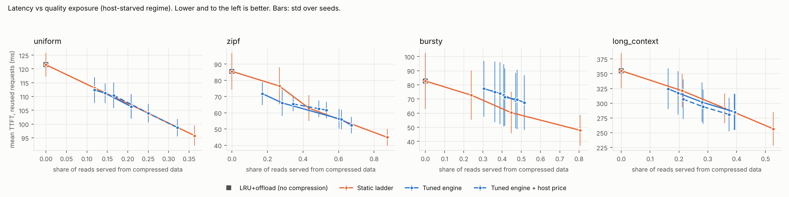
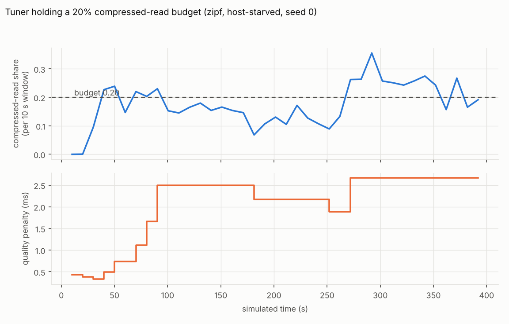

# Adaptive Multi-Tier KV Cache Manager — Core Modules

Implementation status: foundation hardening (Step 1), the event-driven simulator
(Step 2) and the millisecond cost model plus Adaptive Weight Tuner (Step 3) are
complete and evaluated on held-out seeds. Real-trace replay and vLLM integration
are still to come.

## Modules in this package

| Module | File | Status |
|---|---|---|
| Clock abstraction (reproducibility) | `clock.py` | ✅ Implemented + tested |
| Metadata Collector | `metadata_collector.py` | ✅ Implemented + tested |
| Memory Tracker (capacity-enforcing) | `memory_tracker.py` | ✅ Implemented + tested |
| Adaptive Importance Engine | `importance_engine.py` | ✅ Implemented + tested |
| Cost-Benefit Decision Engine | `decision_engine.py` | ✅ Implemented + tested |
| Tier Placement Manager | `placement.py` | ✅ Implemented + tested (single shared implementation) |
| Pressure-driven Controller (hysteresis) | `controller.py` | ✅ Implemented + tested |
| Synthetic workload generator/loader | `workload.py` | ✅ Implemented + tested |
| End-to-end synthetic demo | `simulator.py` | ✅ Implemented |
| Performance Monitor | `performance_monitor.py` | ✅ Implemented + tested |
| FIFO / LRU / MTDS-static baselines | `baselines.py` | ✅ Implemented + tested |
| Snapshot comparison harness (Review-1 demo) | `evaluate.py` | ✅ Implemented + tested |
| Hardware cost model (KV size, PCIe, recompute) | `hardware.py` | ✅ Implemented + tested |
| Request-trace generator (Poisson/bursty, Zipf) | `trace.py` | ✅ Implemented + tested |
| Event-driven simulator | `eventsim.py` | ✅ Implemented + tested |
| Metrics (TTFT percentiles, hit ratios, overheads) | `metrics.py` | ✅ Implemented + tested |
| Policy adapters (Ours, FIFO, LRU, LRU+offload, MTDS-style) | `policies.py` | ✅ Implemented + tested |
| Multi-workload, multi-seed experiment runner | `experiment.py` | ✅ Implemented |
| Cost model in milliseconds (`MsImportanceEngine`) | `costmodel.py` | ✅ Implemented + tested |
| Always-on observation counters (tuner inputs) | `signals.py` | ✅ Implemented + tested |
| Adaptive Weight Tuner (quality-budget feedback loop) | `tuner.py` | ✅ Implemented + tested |
| Paired statistics, latency-vs-quality frontier | `analysis.py` | ✅ Implemented + tested |
| Report figures | `plots.py` | ✅ Implemented (matplotlib optional) |
| Replay of real traces (ShareGPT / LMSYS / BurstGPT) | — | ❌ Not yet implemented |
| vLLM integration | — | ❌ Not yet implemented |

## How the pieces fit together

```
MetadataCollector          (per-block metadata: recency, frequency, size, tier)
        │
        ▼
MemoryTracker               (GPU/CPU capacity accounting, enforced limits, gpu_pressure())
        │
        ▼
PressureDrivenController    (when to act: high/low watermarks with hysteresis;
        │                    whom to act on: lowest importance-per-MB first)
        ▼
AdaptiveImportanceEngine    (5-factor score -> per-action benefit/cost)
        │
        ▼
DecisionEngine               (Net Utility = Benefit − Cost, picks best relief action)
        │
        ▼
TierPlacementManager         (executes MIGRATE / COMPRESS / EVICT with explicit fallbacks)
```

This is the architecture proposed in the Zeroth Review, implemented first as a
self-contained, vLLM-free simulation so the core decision logic can be
validated on its own before the higher-risk vLLM integration.

## Running it

```bash
# Run the full unit test suite (no external dependencies required)
python -m unittest discover -s tests -v

# Run the end-to-end synthetic demo (our engine only)
python -m src.simulator

# Snapshot comparison (old Review-1 harness): Ours vs FIFO vs LRU vs MTDS-static
python -m src.evaluate

# Event-driven experiment: 4 workloads x 5 policies x N seeds (about 1 minute per seed)
python -m src.experiment --seeds 3 --out results/event_sim_3seeds.json
python -m src.experiment --workloads zipf --seeds 5 --duration 200   # quicker

# The full final evaluation (17 policies, two platform regimes, held-out seeds 0-4).
# About 11 minutes per regime on 2 cores; run workloads in chunks if your shell has a time limit.
python -m src.experiment --regime default      --set full --seeds 5 --jobs 2 --out results/full_default.json
python -m src.experiment --regime host-starved --set full --seeds 5 --jobs 2 --out results/full_host_starved.json
python -m src.analysis results/full_default.json results/full_host_starved.json   # paired statistics
python -m src.plots results/full_host_starved.json                                # figures -> results/figures/
```

All runs are deterministic: the workload uses a fixed seed and a fixed
simulated clock, so the output is identical every time.

## What changed in the foundation-hardening step

| Problem found in the first version | Fix |
|---|---|
| Engine had no stopping rule and over-evicted (final GPU utilization ≈ 34% vs ≈ 70% for FIFO/LRU) | `PressureDrivenController`: start shedding at the high watermark (85%), stop at the low watermark (70%) |
| Result depended on the arbitrary order blocks were visited | Victims are ranked by importance per MB; ties broken by block id |
| Thresholds could flip-flop around one value | Hysteresis: a dead band between the two watermarks; optional per-step action limit |
| Memory tiers could be silently overfilled | `MemoryTracker` raises `CapacityError`; moves are atomic |
| MIGRATE with a full CPU tier was undefined | Explicit fallback to EVICT, recorded as `fallback_reason="cpu_full"` |
| A block could be compressed repeatedly | Compress-once guard (engine omits COMPRESS; placement manager no-ops it) |
| Simulator and harness each had their own (already diverging) action-execution code | One `TierPlacementManager` used by every policy |
| Runs depended on `time.time()` | Injectable `Clock`; `ManualClock` makes runs reproducible |
| Baselines were compared under different triggers/targets | Ours, FIFO and LRU share the same trigger and target |

## Event-driven simulator

Unlike the snapshot harness (one decision on a frozen set of blocks), the event
simulator replays a **policy-independent request trace** while time passes:

- **Workload.** A population of conversations; each request needs *all* of its
  conversation's existing KV blocks plus a few new ones. Which conversation is hit
  follows a Zipf law; arrivals are Poisson or bursty. The trace is generated once
  per (workload, seed) and replayed identically against every policy, which removes
  the old circularity (replayed accesses used to be derived from the same
  `access_count` our own score reads).
- **Physical costs.** A GPU hit is free. A CPU-resident block is swapped in over PCIe:
  `setup + size / bandwidth`, queued behind other swap-ins on the same link. An
  evicted block is recomputed: `tokens / prefill throughput`. Block size comes from
  the model's real architecture (`2 × layers × KV heads × head dim × bytes`).
- **Pinning.** A running request's blocks cannot be moved or evicted.
- **Fairness.** All policies share the same platform behaviour: forced LRU eviction
  when a policy frees too little, CPU-tier cleanup, and the "load vs recompute"
  choice for CPU blocks. Ours, FIFO, LRU and LRU+offload share the same trigger
  (85%) and target (70%).
- **Baselines.** FIFO and LRU (eviction only), **LRU+offload** (LRU order but moves
  victims to CPU: the fair tier-aware classical baseline), and **MTDS-style** (a
  simplified static-threshold re-implementation of the base paper's *idea*, not of
  the full MTDS system).

## Cost model in milliseconds (`costmodel.py`)

The first engine compared quantities with no common unit (an importance score in
[0, 1], a size ratio, hand-picked constants), so "Benefit − Cost" was a difference of
unlike things. The millisecond engine fixes that. For a block that must give up GPU
memory, every action has a **cost** (expected future delay, ms) and a **benefit**
(memory freed, valued at a shadow price, ms):

```
expected_reads = reuse_scale × importance                  (importance from recency + frequency)
cost(EVICT)    = expected_reads × recompute_ms
cost(MIGRATE)  = expected_reads × swap_in_ms               (only offered if the CPU has room)
cost(COMPRESS) = expected_reads × (decompress_ms + quality_penalty_ms)
               + host_price × MB                           (host memory is contended too; ablatable)
benefit(a)     = price(GPU pressure) × MB freed by a       price = pressure² × recompute_ms/MB × multiplier
Net Utility    = benefit − cost                             (KEEP is the zero point)
```

**Host-memory shadow price.** A diagnosis of the default regime showed why the first
millisecond engine compressed nothing there: with 4 GB of host memory MIGRATE looked almost
free, so the host filled with blocks that were never read again, the platform then dropped
the least-recently-used host blocks, and they had to be recomputed. The static ladder, which
compresses before offloading, fits about twice as many blocks on the host and suffers about
half the host evictions. `cpu_price_multiplier` (default 0 = off) charges MIGRATE
`host_utilisation² × recompute_ms/MB × multiplier` per MB, mirroring the GPU price. It is an
ablation: `Ours-ms+host+tuner` uses a multiplier of 2, picked on tuning seeds 100-102 (a
sweep of 0.5-4; larger values made the engine compress most reads).

Hardware terms come from `hardware.py`. Three knobs are *exchange rates*, not physical
constants, and are exposed in `MsParams`: `reuse_scale`, `price_multiplier` and
`quality_penalty_ms`. The last one matters most (next section).

## Adaptive Weight Tuner (`tuner.py`)

A rule-based feedback loop that runs every 10 simulated seconds on counters a real
deployment would have (`signals.py`), never on the evaluation metrics:

1. **Quality budget (the main mechanism).** Compression is the only action that costs
   *accuracy*, which the simulator cannot measure. So the operator sets a budget (a cap
   on the share of reads served from compressed data) and the tuner raises
   `quality_penalty_ms` when the budget is exceeded and lowers it when there is slack.
   Latency is then optimised *subject to* a stated quality constraint. The penalty is
   clamped to [0.25 ms, one block's recompute cost]: above that compression is never
   chosen, so a larger value only winds the loop up (compression is sticky; blocks stay
   lossy until evicted).
2. **Shedding watermarks.** Forced evictions or out-of-memory events lower both
   watermarks; quiet windows relax them back. *In our experiments this almost never
   triggers*, so it has no measurable effect.
3. **Recency time constant** (off by default). A static sweep showed the time constant
   is a weak lever (GPU hit ratio moves ~3 points, latency ~2%), and our first rule
   for it pointed the wrong way, so it ships disabled.

Design history worth knowing (it is all in the git log and shaped the final design):
a first tuner version tried to adapt `reuse_scale` and the watermarks from recompute and
OOM signals. It did nothing useful, because `reuse_scale` is flat above 1 and a bug in
the OOM counter had been making the watermark rule fire constantly. The counter bug is
fixed and covered by a regression test; the sensitivity sweep is what showed that
`quality_penalty_ms` is the knob that actually decides behaviour.

## Final evaluation (held-out seeds 0-4, 400 s traces, modelled T4 + ~1B model)

Design decisions (parameter bounds, tuner rules) were made on separate *tuning seeds*
(100-102); everything below uses seeds 0-4, which never influenced a decision. Numbers are
mean TTFT in ms for requests that reuse a conversation (mean ± std over 5 seeds; lower is
better). Raw data: `results/full_*.json`; statistics: `results/analysis.txt`; figures:
`results/figures/`.

Two platform regimes: **default** (1 GB GPU pool, 4 GB host pool; host memory plentiful)
and **host-starved** (512 MB host pool; offloading is no longer free).

**Host-starved regime**

| Policy | zipf | bursty | uniform | long_context | compressed reads (zipf) |
|---|---|---|---|---|---|
| LRU | 117.8 ± 17.4 | 111.0 ± 23.7 | 131.5 ± 3.7 | 422.3 ± 32.7 | 0.00 |
| LRU+offload | 85.5 ± 11.3 | 82.7 ± 19.8 | 121.5 ± 4.3 | 355.0 ± 29.9 | 0.00 |
| MTDS-style | 89.4 ± 16.6 | 85.9 ± 21.0 | 128.4 ± 3.8 | 372.4 ± 26.0 | 0.00 |
| Ours-v1 | 84.8 ± 12.8 | 87.1 ± 20.9 | 121.4 ± 4.6 | 350.3 ± 34.5 | 0.00 |
| Ladder 0.25 | 76.5 ± 11.4 | 72.7 ± 17.3 | 113.1 ± 3.8 | 321.1 ± 28.6 | 0.27 |
| Ours-ms | 52.3 ± 5.0 | 67.9 ± 18.0 | 106.3 ± 4.4 | 284.8 ± 30.5 | 0.67 |
| Ours-ms+tuner b=0.2 | 66.0 ± 8.1 | 75.0 ± 21.4 | 111.2 ± 3.6 | 317.4 ± 37.0 | 0.28 |
| Ours-ms+host+tuner b=0.2 | 65.4 ± 4.6 | 71.3 ± 20.3 | 110.4 ± 4.7 | 306.8 ± 33.5 | 0.34 |

**Default regime**

| Policy | zipf | bursty | uniform | long_context | compressed reads (zipf) |
|---|---|---|---|---|---|
| LRU | 117.8 ± 17.4 | 111.0 ± 23.7 | 131.5 ± 3.7 | 422.3 ± 32.7 | 0.00 |
| LRU+offload | 15.6 ± 1.7 | 15.0 ± 2.7 | 44.4 ± 3.2 | 87.7 ± 20.7 | 0.00 |
| MTDS-style | 17.4 ± 2.2 | 15.5 ± 3.0 | 55.6 ± 3.4 | 108.6 ± 22.5 | 0.00 |
| Ours-v1 | 15.2 ± 1.6 | 15.4 ± 2.2 | 44.3 ± 3.2 | 87.3 ± 21.1 | 0.00 |
| Ladder 0.25 | 11.4 ± 1.6 | 11.2 ± 2.0 | 25.3 ± 3.4 | 54.8 ± 14.8 | 0.23 |
| Ours-ms | 15.2 ± 1.6 | 14.8 ± 2.7 | 44.3 ± 3.2 | 87.3 ± 21.1 | 0.00 |
| Ours-ms+tuner b=0.2 | 15.2 ± 1.6 | 14.9 ± 2.8 | 44.3 ± 3.2 | 87.3 ± 21.1 | 0.00 |
| Ours-ms+host+tuner b=0.2 | 14.6 ± 1.9 | 14.0 ± 2.5 | 26.5 ± 4.4 | 60.3 ± 21.5 | 0.30 |





### What these results do and do not show

All "significant" claims below are paired differences over seeds whose 95% interval
excludes zero (`python -m src.analysis`).

1. **Using the host tier is the big win over eviction-only policies** (FIFO/LRU), by roughly
   5-20x on P50 TTFT in the default regime. That follows from the hardware model (a swap-in
   is far cheaper than a recompute), not from our scoring.
2. **When host memory is scarce, the millisecond engine is clearly better.** Ours-ms is
   significantly faster than `LRU+offload` on all four workloads (−15 to −70 ms), than
   MTDS-style, and than the first-generation engine (Ours-v1: −15 to −65 ms). It is the
   first version in which COMPRESS is ever chosen.
3. **That gain is bought with accuracy we cannot measure.** Ours-ms serves 40-67% of reads
   from compressed data. The simulator has no accuracy model, so `quality_penalty_ms`
   is the only place that cost enters; at penalties of about 2 ms or more compression is
   never chosen and the gain disappears (it falls back to `LRU+offload`). A real quality
   measurement (for example perplexity with a quantised KV cache in vLLM) is required
   before these latency numbers can be called wins.
4. **At equal compressed-read exposure, versus a static compress-first ladder, the result is
   mixed.** On `zipf` the tuned engine is 10-12% faster at low exposure (0.17-0.28) and on
   par at higher exposure; on `long_context` it is about 1.5% faster at low exposure and on
   par above; on `uniform` it is on par; on **`bursty` it is 12-16% slower**. We have a
   hypothesis for the bursty loss (recency/frequency scoring reacts more slowly than plain
   LRU to sudden hot-set changes) but have not tested it.
5. **The quality budget is only a soft target.** Realised exposure overshoots it, for
   example a budget of 0.1 gave 0.17 (zipf), 0.31 (bursty) and 0.16 (long_context).
   Compressed blocks stay lossy until evicted, so exposure lags the controller. A hard cap
   on compressed blocks would be needed for a guarantee.
6. **With plentiful host memory the engine without a host price compresses nothing and ties
   `LRU+offload`; the host price fixes most of that.** With it, `Ours-ms+host+tuner b=0.2`
   is significantly faster than `LRU+offload` on `uniform` (−18 ms) and `long_context`
   (−27 ms), and at equal exposure it is within about 1-3% of the static ladder there. It
   does **not** close the gap on `zipf` and `bursty`: there it is still about 3-4 ms (35-45%)
   slower than the ladder at equal exposure. Our diagnosis is that the ladder keeps *cold*
   blocks compressed on the GPU instead of moving them, which the per-block cost model does
   not capture; we have not yet tested that. In the host-starved regime the host price is a
   mixed bag (better on `long_context`, −14 ms vs the ladder; about equal elsewhere), so it
   remains an ablation rather than the default. The multiplier was chosen on tuning seeds;
   the held-out numbers above are a fair test of it.
7. **The tuner's contribution is the quality budget, not extra speed.** With a budget of 1.0
   it never binds and equals the static engine. The watermark mechanism never triggered.

### Known simplifications (state these in the report)

- No request queueing, batching or GPU compute contention, so there is **no
  throughput metric** and TTFT excludes scheduling delay.
- **No accuracy model.** Compression is charged only through `quality_penalty_ms` and
  reported as "compressed-read exposure"; real quality loss is unmeasured.
- Frontier comparisons interpolate the ladder's curve linearly between a few sampled points.
- Five seeds per cell give wide intervals; effects of a few percent should not be trusted.
- Memory freed by MIGRATE becomes available immediately (real systems free it when
  the device-to-host copy finishes); offload time is tracked but kept off the request path.
- Recomputing a block costs `tokens / prefill throughput` regardless of position.
- All blocks are the same size; pools are scaled down (1 GB GPU / 4 GB CPU) so the
  *ratio* of working set to GPU memory creates pressure while runs stay fast.
- Bandwidth and throughput values are **assumed typical figures, not measurements**
  (`hardware.py`); calibrate them on real hardware during vLLM integration.
- The workload is a *model* of conversation reuse, not a replay of real traces.

### Earlier snapshot harness (`evaluate.py`)

Kept as a Review-1 demonstration of the decision logic on a frozen set of blocks.
Its latency model is flat (2 / 12 / 80 ms per tier) and its replayed accesses derive
from `access_count`, so its numbers should **not** be quoted as evidence; use the
event-driven results above instead.

## Design rationale (for the Review presentation)

- **Why a constrained, pressure-driven controller instead of independent
  per-block decisions:** a cache manager's real job is "keep utilization under a
  limit while losing as little future value as possible". The controller states
  that constraint explicitly; the Decision Engine then picks the cheapest way to
  shed each chosen block. Excluding KEEP in this phase is deliberate: the
  pressure constraint has already decided that memory must be freed.

- **Why value density (importance ÷ size) picks victims:** shedding the block
  with the least keep-worth per megabyte frees the most memory for the least
  value lost, the standard greedy rule for knapsack-style problems.

- **Why two watermarks:** with a single threshold, utilization hovering near it
  would trigger shedding, stop, and trigger again. The gap (hysteresis) makes
  shedding decisive and stable.

- **Why five factors feed one importance score, not five separate rules:**
  recency and frequency combine into a single bounded importance value; migration
  cost, compression benefit and GPU pressure then shape the benefit/cost of each
  *specific action*. This keeps the scoring interpretable.

- **Why costs are normalized against a reference block size instead of total
  GPU capacity:** a single block is a tiny fraction of GPU capacity, which would
  make the benefit of freeing it negligible next to a [0, 1] importance score
  and bias the engine toward keeping everything. (This normalization is one of
  the items to be revisited when costs move to a common time unit.)

- **Why `DecisionEngine` still accepts plain `{"benefit", "cost"}` dicts:**
  backward compatibility with the module as first committed; it also accepts
  `ActionEstimate` objects from `AdaptiveImportanceEngine`.
